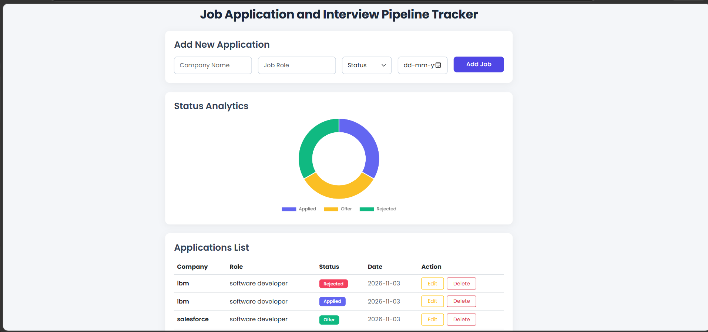

# Job Application and Interview Pipeline Tracker

A clean, modern web application built to organize and track job hunting progress, application statuses, and interview pipelines.

## Tech Stack
- *Backend:* Python, Flask
- *Database:* SQLite3
- *Frontend:* HTML5, Bootstrap 5, Google Fonts (Poppins)
- *Analytics:* Chart.js (Doughnut variant)

## Features
- *Add Applications:* Record company name, job role, application status, and date.
- *Interactive Analytics:* Visual representation of application statuses (Applied, Interviewing, Offer, Rejected) using Chart.js.
- *Update and Delete:* Full capability to edit application details or remove outdated entries.
- *Responsive Layout:* Clean vertical workflow designed for a smooth user experience.

## Preview
